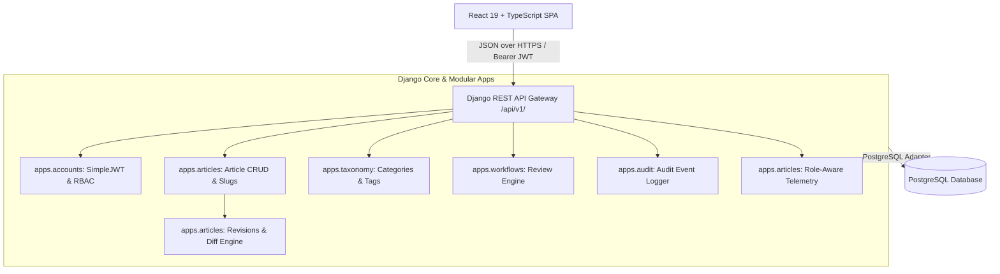
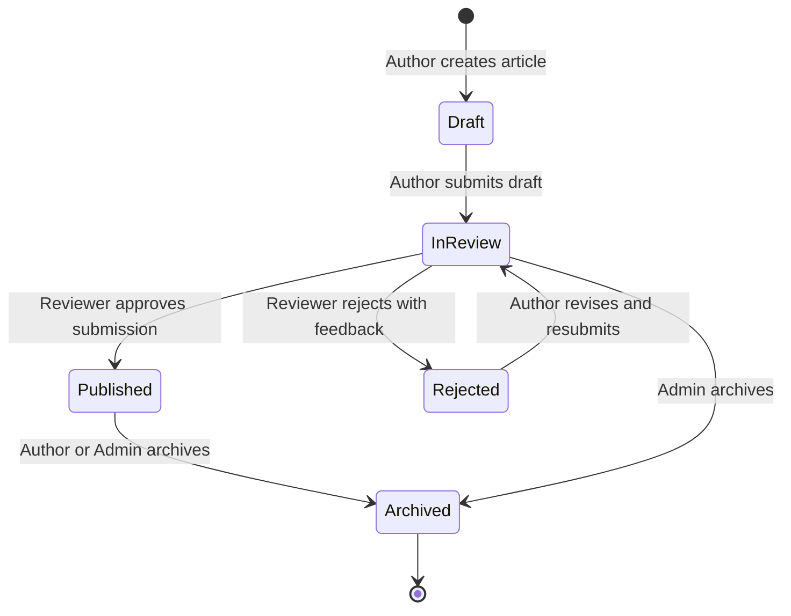

# Internal Knowledge Base & Company Wiki

[](https://www.djangoproject.com/)
[](https://www.django-rest-framework.org/)
[](https://www.postgresql.org/)
[](https://react.dev/)
[](https://www.typescriptlang.org/)
[](https://tailwindcss.com/)
[](https://vitejs.dev/)

A professional, enterprise-grade, portfolio-quality centralized web platform for capturing, organizing, reviewing, publishing, and discovering company-wide internal knowledge and documentation.

Built with a decoupled **Django REST Framework** backend backed by **PostgreSQL** and a high-performance **React 19 + TypeScript + Vite + Tailwind CSS** frontend.

---

## Table of Contents
- [1. Overview & Core Problem Solved](#1-overview--core-problem-solved)
- [2. System Architecture](#2-system-architecture)
- [3. Key Features](#3-key-features)
- [4. Role-Based Access Control (RBAC)](#4-role-based-access-control-rbac)
- [5. Article Editorial Workflow](#5-article-editorial-workflow)
- [6. Technology Stack](#6-technology-stack)
- [7. Project Directory Structure](#7-project-directory-structure)
- [8. Getting Started & Setup Guide](#8-getting-started--setup-guide)
  - [Prerequisites](#prerequisites)
  - [Database Setup](#database-setup)
  - [Backend Setup (Pipenv)](#backend-setup-pipenv)
  - [Frontend Setup (npm)](#frontend-setup-npm)
- [9. Automated Testing](#9-automated-testing)
- [10. API Specification Overview](#10-api-specification-overview)
- [11. Security & Compliance Defenses](#11-security--compliance-defenses)
- [12. Troubleshooting & FAQ](#12-troubleshooting--faq)
- [13. License](#13-license)

---

## 1. Overview & Core Problem Solved
Modern organizations frequently suffer from knowledge fragmentation: critical engineering procedures, system setup guides, HR policies, and onboarding documentation are scattered across disconnected Slack threads, personal markdown notes, and local files.

The **Internal Knowledge Base & Company Wiki** solves this by delivering:
- A single source of truth for technical documentation and standard operating procedures (SOPs).
- Strict separation between drafts, articles under editorial review, published documentation, and historical archives.
- Multi-tier editorial governance preventing unauthorized or unreviewed content publication.
- Complete audit trails and linear revision history preserving institutional knowledge over time.

---

## 2. System Architecture



---

## 3. Key Features
- **Secure Authentication**: SimpleJWT token lifecycle with automated credential evaluation, refresh rotation, and token blacklisting on logout.
- **Dynamic Role-Aware Dashboard**: Real-time telemetry displaying published documentation counts, personal drafting workloads, editorial review backlogs, and system-wide audit activity.
- **Full Article CRUD & Safe Archival**: Authoring with auto-generated URL slugs, reading time calculation, draft protection, and soft-archival preserving citations.
- **Taxonomy Organization**: Hierarchical categories with custom UI theme tokens, reusable tags, and category distribution metrics.
- **Multi-Field Search & Safe Sorting**: Server-side search across title, summary, content, category, and tags, combined with whitelisted sorting and pagination.
- **Multi-Tier Editorial Workflow**: Strict status transitions (`draft` $\rightarrow$ `in_review` $\rightarrow$ `published` / `rejected` $\rightarrow$ `archived`) with mandatory rejection feedback.
- **Linear Revision History & Unified Diff**: Immutable revision snapshots, addition/deletion line metrics, and non-destructive rollbacks.
- **Comprehensive Audit Trail**: Security-conscious audit logging attributing all account, content, taxonomy, and workflow events to authenticated actors.

---

## 4. Role-Based Access Control (RBAC)

| Capability / Action | Administrator | Author | Reviewer | Reader |
| :--- | :---: | :---: | :---: | :---: |
| Browse Published Documentation | Yes | Yes | Yes | Yes |
| Search & Filter Knowledge Base | Yes | Yes | Yes | Yes |
| Create & Edit Own Drafts | Yes | Yes | No | No |
| Submit Drafts for Review | Yes | Yes | No | No |
| Approve / Reject Submissions | Yes | No (Independent) | Yes | No |
| Manage Taxonomy (Categories/Tags) | Yes | No | No | No |
| Manage User Roles & Accounts | Yes | No | No | No |
| Inspect Full Audit History | Yes | No | No | No |
| Revisions: View History & Diff | Yes | Yes (Own) | Yes (In Review) | No |
| Revisions: Restore Version | Yes | Yes (Draft/Rejected) | No | No |

---

## 5. Article Editorial Workflow



* **Independent Review Constraint**: Authors cannot review or approve their own submissions (unless acting as Administrator), ensuring impartial quality control.
* **Non-Destructive Restores**: Restoring an earlier revision creates a new revision snapshot #N, preserving intermediate history intact.

---

## 6. Technology Stack

### Backend
- **Framework**: Django 5.0+ & Django REST Framework 3.15+
- **Authentication**: DRF SimpleJWT (JSON Web Tokens)
- **Database**: PostgreSQL 14+
- **Environment & Dependencies**: Pipenv (Mandatory)
- **Versioned API**: `/api/v1/`

### Frontend
- **Library**: React 19
- **Language**: TypeScript 5.5+
- **Build Tool**: Vite 5.4+
- **Styling**: Tailwind CSS 3.4+
- **Routing**: React Router 6.22+
- **Icons**: Lucide React

---

## 7. Project Directory Structure

```text
company-wiki/
├── backend/
│   ├── Pipfile & Pipfile.lock       # Strict dependency lockfiles
│   ├── manage.py                    # Django administration entrypoint
│   ├── core/                        # Project settings, root URL routing, E2E tests
│   │   ├── settings.py
│   │   ├── urls.py
│   │   └── tests_e2e_scenarios.py   # 10 core integration scenarios
│   ├── apps/
│   │   ├── accounts/                # CustomUser model, JWT auth, user governance
│   │   ├── articles/                # Article model, revisions, diff engine, dashboard
│   │   ├── taxonomy/                # Category and Tag models, seed commands
│   │   ├── workflows/               # Review queue, approval/rejection state machine
│   │   └── audit/                   # AuditEvent model, logging services, views
│   └── .env.example                 # Backend environment variable template
├── frontend/
│   ├── package.json & package-lock.json
│   ├── vite.config.ts
│   ├── tailwind.config.js
│   ├── src/
│   │   ├── app/                     # Application entry point
│   │   ├── components/              # Reusable UI cards, badges, modals, markdown
│   │   ├── context/                 # AuthContext & token management
│   │   ├── layouts/                 # MainLayout with header and sidebar
│   │   ├── pages/                   # Route-driven dashboard, articles, reviews, audit
│   │   ├── services/                # Axios API clients (articles, workflow, audit, etc.)
│   │   └── types/                   # TypeScript interfaces matching DRF serializers
│   └── .env.example                 # Frontend API URL configuration
├── docs/                            # Architecture, API specs, Postman guide, logs
└── README.md                        # Project root documentation
```

---

## 8. Getting Started & Setup Guide

### Prerequisites
- **Python**: 3.12 or 3.14+
- **Node.js**: 18.0+ & npm 9.0+
- **PostgreSQL**: 14.0+ installed and running locally
- **Pipenv**: Installed globally (`pip install pipenv`)

### Database Setup
Open PostgreSQL shell or pgAdmin and create the database:
```sql
CREATE DATABASE company_wiki_db;
CREATE USER postgres WITH PASSWORD 'postgres';
GRANT ALL PRIVILEGES ON DATABASE company_wiki_db TO postgres;
```

### Backend Setup (Pipenv)
1. Navigate to the backend directory:
   ```bash
   cd backend
   ```
2. Copy environment variables:
   ```bash
   cp .env.example .env
   ```
3. Install dependencies using Pipenv:
   ```bash
   pipenv install --dev
   ```
4. Run database migrations:
   ```bash
   pipenv run python manage.py migrate
   ```
5. Seed initial taxonomy categories and tags:
   ```bash
   pipenv run python manage.py seed_taxonomy
   ```
6. Start the Django development server:
   ```bash
   pipenv run python manage.py runserver
   ```
   Backend will be accessible at: `http://127.0.0.1:8000/`

### Frontend Setup (npm)
1. Open a new terminal and navigate to the frontend directory:
   ```bash
   cd frontend
   ```
2. Copy environment configuration:
   ```bash
   cp .env.example .env
   ```
3. Install npm dependencies:
   ```bash
   npm install
   ```
4. Start the Vite development server:
   ```bash
   npm run dev
   ```
   Frontend will be accessible at: `http://localhost:5173/`

---

## 9. Automated Testing

### Backend Test Suites
Run all automated test suites across all applications (117+ tests):
```bash
cd backend
pipenv run python manage.py test
```

Run specific test modules:
```bash
# E2E Integration Scenarios
pipenv run python manage.py test core.tests_e2e_scenarios

# Role-Aware Dashboard Tests
pipenv run python manage.py test apps.articles.tests_dashboard

# Article CRUD & Revisions Tests
pipenv run python manage.py test apps.articles.tests apps.articles.tests_revisions
```

### Frontend Build Validation
Verify TypeScript types and Vite bundle creation:
```bash
cd frontend
npm run build
```

---

## 10. API Specification Overview

All versioned endpoints are prefixed under `/api/v1/`:

| Module | Method | Endpoint | Description |
| :--- | :---: | :--- | :--- |
| **Auth** | `POST` | `/api/v1/auth/login/` | Obtain access and refresh JWT pair |
| **Auth** | `POST` | `/api/v1/auth/refresh/` | Renew access token via refresh token |
| **Auth** | `POST` | `/api/v1/auth/logout/` | Revoke session and blacklist refresh token |
| **Auth** | `GET` | `/api/v1/auth/me/` | Retrieve current authenticated user profile |
| **Dashboard** | `GET` | `/api/v1/dashboard/` | Role-tailored dashboard metrics and feeds |
| **Articles** | `GET` | `/api/v1/articles/` | Search, filter, and paginate accessible articles |
| **Articles** | `POST` | `/api/v1/articles/` | Create a new article draft (Authors/Admins) |
| **Articles** | `GET` | `/api/v1/articles/{slug}/` | Retrieve full article detail and metadata |
| **Articles** | `PUT` | `/api/v1/articles/{slug}/` | Update article and generate revision snapshot |
| **Articles** | `DELETE`| `/api/v1/articles/{slug}/` | Delete draft or soft-archive active article |
| **Workflow** | `POST` | `/api/v1/articles/{slug}/submit/` | Submit draft for editorial review |
| **Workflow** | `POST` | `/api/v1/articles/{slug}/approve/` | Approve submission and publish to wiki |
| **Workflow** | `POST` | `/api/v1/articles/{slug}/reject/` | Reject submission with mandatory feedback |
| **Workflow** | `GET` | `/api/v1/workflows/queue/` | View pending review queue (Reviewers/Admins) |
| **Revisions**| `GET` | `/api/v1/articles/{slug}/revisions/` | List all historical snapshots of an article |
| **Revisions**| `GET` | `/api/v1/articles/{slug}/revisions/diff/` | Unified diff with line addition/deletion metrics |
| **Revisions**| `POST` | `/api/v1/articles/{slug}/revisions/{num}/restore/` | Restore prior revision non-destructively |
| **Taxonomy** | `GET` | `/api/v1/categories/` | List all taxonomy departments and categories |
| **Taxonomy** | `GET` | `/api/v1/tags/` | List reusable topical tags |
| **Users** | `GET` | `/api/v1/users/` | List employee directory (Admins only) |
| **Users** | `PATCH`| `/api/v1/users/{id}/role/` | Promote or reassign employee role (Admins) |
| **Audit** | `GET` | `/api/v1/audit/` | Browse immutable system audit log (Admins) |

---

## 11. Security & Compliance Defenses
1. **SQL Injection**: 100% ORM parameterized queries across all endpoints; zero raw SQL strings.
2. **Cross-Site Scripting (XSS)**: Safe Markdown parsing into native React elements without `dangerouslySetInnerHTML`.
3. **Privilege Escalation**: Server-side role assignment; public registration strictly forces `READER` role.
4. **Data Isolation**: Queryset-level scoping ensures unauthorized users cannot discover the existence of confidential drafts via ID guessing (returns `404 Not Found`).
5. **Audit Sanitization**: Passwords, hashes, and token secrets are strictly masked from audit events and logs.

---

## 12. Troubleshooting & FAQ

* **Issue: `database "company_wiki_db" does not exist`**
  - *Solution*: Create the database in PostgreSQL via `psql -U postgres -c "CREATE DATABASE company_wiki_db;"`.
* **Issue: `Pipenv command failed`**
  - *Solution*: Ensure Python 3.12+ is installed and on your PATH. Run `pip install --user pipenv` and retry `pipenv install`.
* **Issue: `CORS error in browser console`**
  - *Solution*: Verify `CORS_ALLOWED_ORIGINS` in `backend/.env` matches the frontend Vite URL (e.g., `http://localhost:5173`).
* **Issue: `Token is invalid or expired`**
  - *Solution*: Sign out and log back in to obtain a freshly signed JWT pair.

---

## 13. License
This project is developed for educational and portfolio demonstration purposes. All source code is released under the MIT License.
