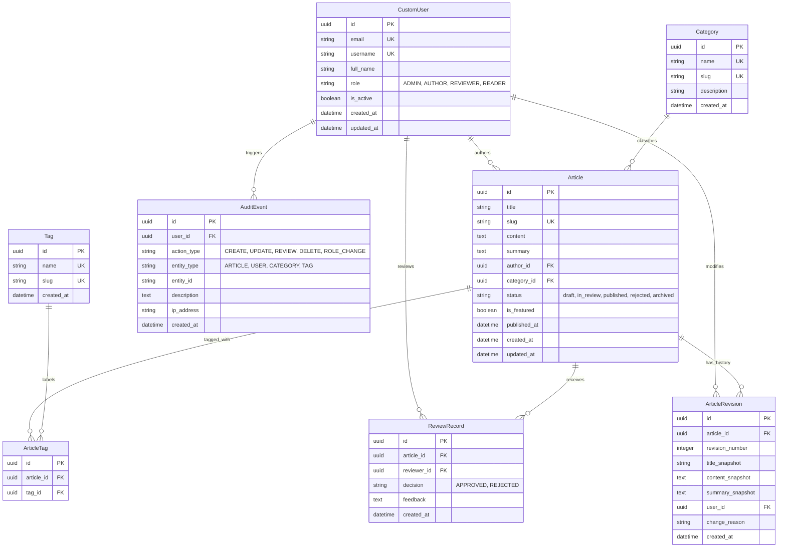
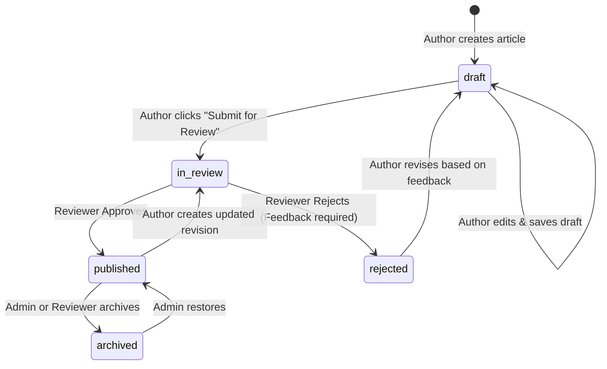

# Internal Knowledge Base & Company Wiki
## Complete Architecture Specification, Requirements Document, and Phase 0 Plan

---

## 1. Executive Summary & Product Specification

### 1.1 Product Vision
The **Internal Knowledge Base & Company Wiki** is a centralized, role-governed documentation and knowledge management web application designed for companies and engineering teams. It replaces disjointed Google Docs, Slack/Telegram threads, and loose text files with a structured, version-controlled, searchable, and auditable single source of truth.

### 1.2 Target Audience & Roles
* **Administrator:** Manages system users, role assignments, global taxonomy (categories/tags), and system audit logs.
* **Author:** Creates, drafts, edits, and submits documentation for review.
* **Reviewer:** Evaluates submitted articles, enforces quality standards, provides constructive rejection feedback, and approves articles for publication.
* **Reader:** Discovers, searches, filters, and reads published documentation.

### 1.3 Core Capabilities
1. Secure JWT-based authentication and role-based access control.
2. Markdown and rich-text document authoring with safe rendering.
3. Strict article review workflow: `draft` -> `in_review` -> `published` / `rejected` -> `archived`.
4. Immutable article revision history and audit logging.
5. Multi-faceted content discovery: server-side full-text search, category trees, tag clouds, sorting, and pagination.
6. Role-aware dashboard displaying personalized metrics, active drafts, and review queues.

---

## 2. Workspace Inspection & Environment Audit

* **Repository Location:** `C:\company-wiki`
* **Initial State:** Empty directory. Git repository initialized; remote configured to `https://github.com/DagnexCru/company-wiki.git`.
* **Installed Tooling Audit:**
  * **Git:** `2.51.2.windows.1` [INSTALLED]
  * **PostgreSQL:** `psql (PostgreSQL) 18.4` [INSTALLED]
  * **Python:** No active Python runtime detected (`py.exe` launcher found, but no Python version registered). **[ACTION REQUIRED]**
  * **Pipenv:** Not yet available (requires Python). **[ACTION REQUIRED]**
  * **Node.js & npm:** Node runtime not found on PATH. **[ACTION REQUIRED]**

---

## 3. Division of Responsibilities (Every Phase)

To ensure smooth pair programming, clear boundaries are maintained between the **AI Senior Engineer** and the **CS Student / Lead Reviewer**:

| Phase | AI Senior Engineer Responsibilities | User (CS Student / Lead Reviewer) Responsibilities |
| :--- | :--- | :--- |
| **Prerequisites / Setup** | Provide exact install links and verify environment in terminal | 1. Install Python (3.11/3.12) with "Add to PATH" checked.<br>2. Install Node.js LTS (v20+).<br>3. Open pgAdmin and create a PostgreSQL database named `company_wiki_db`. |
| **Phase 0** | Workspace discovery, ER design, API plan, permission matrix, UI proposal, Git setup. | Review and approve Phase 0 architecture and UI design. |
| **Phase 1** | Configure Pipenv, Django project, DRF, PostgreSQL connection, Vite, React, Tailwind, `/health/` API. | Provide PostgreSQL credentials in `.env`, verify `/health/` in browser, approve Phase 1. |
| **Phase 2** | Implement CustomUser model, SimpleJWT authentication, login/register API, protected React routes. | Test registration and login in Postman, test browser login flow, approve Phase 2. |
| **Phase 3** | Implement Article model, CRUD endpoints, serializers, author permissions, React article editor. | Test article creation and editing in Postman and UI, approve Phase 3. |
| **Phase 4** | Implement Category & Tag models, taxonomy management API, React category/tag selector. | Review taxonomy structure, test filtering in Postman, approve Phase 4. |
| **Phase 5** | Implement DRF role permission classes, object-level security, role-gated UI navigation. | Test role boundaries (e.g. Reader cannot edit) in Postman, approve Phase 5. |
| **Phase 6** | Implement server-side search, filtering, sorting, pagination, and React search bar. | Verify search edge cases in Postman and UI, approve Phase 6. |
| **Phase 7** | Implement workflow state machine (`in_review`, `published`, `rejected`), review queue, and UI. | Act as Reviewer in UI/Postman: approve and reject an article, verify author feedback. |
| **Phase 8** | Implement ArticleRevision model, snapshot creation, AuditEvent logging, and UI history views. | Inspect revision diffs in UI, verify audit events, approve Phase 8. |
| **Phase 9** | Implement role-aware metrics API, dashboard aggregation queries, and React widgets. | Verify dashboard numbers match real database counts, approve Phase 9. |
| **Phase 10** | Run automated test suites, conduct security audits, test accessibility and responsive layouts. | Conduct end-to-end user testing across all 4 roles, approve Phase 10. |
| **Phase 11** | Write comprehensive README, setup guides, Postman export, and troubleshooting docs. | Follow setup guide on local machine to verify reproducibility, approve Phase 11. |
| **Phase 12** | Perform release readiness audit, check production settings, environment isolation. | Final review and official project sign-off. |

---

## 4. Backend Architecture & Django Application Decomposition

The backend will be structured into decoupled, single-responsibility Django apps within `company-wiki/backend/`:

```
backend/
├── Pipfile
├── Pipfile.lock
├── manage.py
├── core/                        # Project configuration & base settings
│   ├── settings/
│   │   ├── base.py
│   │   ├── development.py
│   │   └── production.py
│   ├── urls.py                  # Master routing (/api/v1/)
│   └── wsgi.py
├── apps/
│   ├── accounts/                # CustomUser model, JWT auth, user profile, role logic
│   ├── articles/                # Article model, CRUD views, serializers, slug generation
│   ├── taxonomy/                # Category and Tag models, hierarchical categories
│   ├── workflows/               # Article review state machine, approval/rejection logic
│   └── audit_trail/             # Article revisions snapshotting, system audit events
└── tests/                       # Global integration & end-to-end tests
```

### Why this architecture?
* **Separation of Concerns:** Business logic for workflows (approvals/rejections) is separated from basic article storage.
* **Maintainability:** As the codebase expands, individual apps remain lightweight, testable, and cleanly isolated.

---

## 5. Frontend Architecture & React Module Structure

The frontend will reside in `company-wiki/frontend/` using Vite, React 18/19, TypeScript, and Tailwind CSS:

```
frontend/
├── package.json
├── vite.config.ts
├── tailwind.config.js
├── tsconfig.json
├── src/
│   ├── app/                     # App-level routing and providers (AuthContext, QueryClient)
│   ├── assets/                  # Static logos, icons, illustrations
│   ├── components/              # Shared UI design system primitives
│   │   ├── Button.tsx
│   │   ├── Input.tsx
│   │   ├── Modal.tsx
│   │   ├── Badge.tsx
│   │   ├── Card.tsx
│   │   └── Table.tsx
│   ├── layouts/                 # Shell layouts
│   │   ├── MainLayout.tsx       # Sidebar + Header + Breadcrumb + Content shell
│   │   └── AuthLayout.tsx       # Clean centered layout for Login/Register
│   ├── features/                # Domain-specific feature modules
│   │   ├── auth/                # Login, Register, ProtectedRoute
│   │   ├── articles/            # ArticleList, ArticleDetail, ArticleEditor
│   │   ├── review/              # ReviewQueue, DecisionModal
│   │   ├── taxonomy/            # CategoryManager, TagSelector
│   │   ├── revisions/           # RevisionDiffViewer, HistoryTimeline
│   │   └── dashboard/           # MetricsCard, RecentActivityWidget
│   ├── services/                # Axios API client configured with JWT interceptors
│   ├── hooks/                   # Custom hooks (useAuth, useDebounce, useArticles)
│   ├── types/                   # TypeScript interfaces matching DRF serializers
│   └── utils/                   # Date formatters, slugifiers, sanitizers
```

---

## 6. Database Entity Relationship Model (ERD)



### Database Integrity Constraints
1. **Unique Constraints:** `CustomUser.email`, `Category.slug`, `Tag.slug`, `Article.slug`, `(article_id, tag_id)` in `ArticleTag`, and `(article_id, revision_number)` in `ArticleRevision`.
2. **On-Delete Rules:**
   * `Article.author` -> `ON DELETE RESTRICT` (Never delete active articles if an author account is deactivated).
   * `Article.category` -> `ON DELETE PROTECT` (Cannot delete a category containing active articles; articles must be reassigned first).
   * `ArticleTag` -> `ON DELETE CASCADE` (Removing a tag removes the association, not the article).
   * `ArticleRevision` -> `ON DELETE CASCADE` (Retained with the article lifecycle).
   * `AuditEvent` -> `ON DELETE SET NULL` (Audit events remain preserved even if a user account is deleted).

---

## 7. User Role and Permission Matrix

| Resource / Action | Administrator | Author | Reviewer | Reader | Unauthenticated |
| :--- | :---: | :---: | :---: | :---: | :---: |
| **View Published Articles** | ✅ Yes | ✅ Yes | ✅ Yes | ✅ Yes | ❌ No (Internal) |
| **View Own Drafts** | ✅ Yes | ✅ Yes | ✅ Yes | ❌ No | ❌ No |
| **View Other Authors' Drafts** | ✅ Yes | ❌ No | ❌ No | ❌ No | ❌ No |
| **Create New Article** | ✅ Yes | ✅ Yes | ❌ No | ❌ No | ❌ No |
| **Edit Own Draft** | ✅ Yes | ✅ Yes | ❌ No | ❌ No | ❌ No |
| **Edit Other's Draft** | ✅ Yes | ❌ No | ❌ No | ❌ No | ❌ No |
| **Submit Draft for Review** | ✅ Yes | ✅ Yes | ❌ No | ❌ No | ❌ No |
| **View Review Queue** | ✅ Yes | ❌ No | ✅ Yes | ❌ No | ❌ No |
| **Approve Article** | ✅ Yes | ❌ No | ✅ Yes (Cannot approve own) | ❌ No | ❌ No |
| **Reject Article (with feedback)** | ✅ Yes | ❌ No | ✅ Yes (Cannot reject own) | ❌ No | ❌ No |
| **Publish Article Directly** | ✅ Yes | ❌ No | ❌ No | ❌ No | ❌ No |
| **Manage Taxonomy (Categories/Tags)** | ✅ Yes | ❌ No | ❌ No | ❌ No | ❌ No |
| **Manage User Roles** | ✅ Yes | ❌ No | ❌ No | ❌ No | ❌ No |
| **View Full Audit Trail** | ✅ Yes | ❌ No | ❌ No | ❌ No | ❌ No |
| **View Article Revision History** | ✅ Yes | ✅ Yes (Own articles) | ✅ Yes | ❌ No | ❌ No |

*Note: All permissions are strictly enforced on the Django REST Framework API layer using custom DRF permission classes.*

---

## 8. Article Lifecycle State Machine



### Transition Enforcement Rules
* A client cannot set `"status": "published"` directly via a normal PATCH/PUT endpoint.
* Transitions from `in_review` to `published` or `rejected` can only be performed via the dedicated endpoint `/api/v1/articles/{id}/review-decision/` by an authenticated Reviewer or Admin.
* A Reviewer is blocked by backend validation from approving their own submitted article.

---

## 9. Versioned REST API Plan (`/api/v1/`)

### 9.1 Authentication & Profile (`/api/v1/auth/`)
* `POST /api/v1/auth/register/` - Register account (requires approval or initial admin role).
* `POST /api/v1/auth/login/` - Authenticate with email/password; returns access & refresh JWT tokens.
* `POST /api/v1/auth/refresh/` - Refresh expired access token.
* `POST /api/v1/auth/logout/` - Blacklist refresh token.
* `GET  /api/v1/auth/me/` - Retrieve authenticated user profile, permissions, and role.

### 9.2 Knowledge Articles (`/api/v1/articles/`)
* `GET    /api/v1/articles/` - List accessible articles (with server-side search, filtering, pagination).
* `POST   /api/v1/articles/` - Create a new article in `draft` status.
* `GET    /api/v1/articles/{slug_or_id}/` - Retrieve full article details.
* `PUT/PATCH /api/v1/articles/{slug_or_id}/` - Update draft or editable content.
* `DELETE /api/v1/articles/{slug_or_id}/` - Soft-delete or archive article (Admin only).

### 9.3 Content Workflow (`/api/v1/articles/{id}/workflow/`)
* `POST /api/v1/articles/{id}/submit/` - Transition from `draft` to `in_review`.
* `GET  /api/v1/workflow/review-queue/` - Reviewer queue of pending articles.
* `POST /api/v1/articles/{id}/review-decision/` - Approve or reject an article.

### 9.4 Taxonomy (`/api/v1/taxonomy/`)
* `GET  /api/v1/taxonomy/categories/` - List categories with article counts.
* `POST /api/v1/taxonomy/categories/` - Create category (Admin only).
* `GET  /api/v1/taxonomy/tags/` - List all tags.
* `POST /api/v1/taxonomy/tags/` - Create tag.

### 9.5 Revisions & Audit (`/api/v1/history/`)
* `GET /api/v1/articles/{id}/revisions/` - List revision snapshots for an article.
* `GET /api/v1/audit-events/` - List system audit logs (Admin only).

### 9.6 Dashboard Metrics (`/api/v1/dashboard/`)
* `GET /api/v1/dashboard/stats/` - Role-aware metrics (total published, pending reviews, active drafts).

---

## 10. UI/UX Design System Proposal

### 10.1 Design Philosophy
A SaaS-grade internal tool inspired by modern platforms (Notion, Linear, GitHub Docs, Outline). It features:
* **Focus & Readability:** Generous line-height (`1.75`), readable sans-serif typography (`Inter`), and distraction-free document views.
* **Curated Color Palette:**
  * **Backgrounds:** Slate-50 (Light) / Slate-950 (Dark)
  * **Surfaces & Cards:** White (Light) / Slate-900 with subtle 1px border Slate-800 (Dark)
  * **Brand Primary:** Deep Indigo (`#4F46E5` / Tailwind `indigo-600`)
  * **Accent / Success:** Emerald (`#10B981`) for Published status
  * **Warning:** Amber (`#F59E0B`) for In-Review status
  * **Danger:** Rose (`#F43F5E`) for Rejected status
* **Interactive Elements:**
  * Keyboard shortcut command palette (`Ctrl + K`) for instant article search.
  * Status badges with color-coded pulsing indicator dots.
  * Markdown previewer with syntax highlighting for code blocks.

### 10.2 Core Screen Layouts
1. **Application Shell (`MainLayout`):**
   * **Left Sidebar (260px):** Logo, quick action ("+ New Article"), Search trigger (`Ctrl+K`), Navigation links (Dashboard, Browse Categories, My Drafts, Review Queue [Reviewers only], Admin [Admin only]), User profile avatar & logout.
   * **Top Bar:** Breadcrumb navigation, global search bar, dark/light mode toggle.
   * **Main Content Area:** Max width `1280px` centered with responsive padding.
2. **Article Reader View:**
   * Left: Sticky hierarchical table of contents (TOC).
   * Center: Document body with rich headings, callout boxes, code snippets, and author/date metadata.
   * Right: Metadata pane (Category, Tags, Version number, Last updated, Workflow status badge).
3. **Article Editor View:**
   * Split-pane or toggleable Markdown editor with real-time preview, word count, tag selector, category dropdown, and "Save Draft" / "Submit for Review" action bar.

---

## 11. Environment & Dependency Plan

### 11.1 Backend Dependencies (Managed exclusively via `Pipenv`)
* `python = "3.11"` or `"3.12"`
* `django = "~=5.0"`
* `djangorestframework = "~=3.15"`
* `djangorestframework-simplejwt = "~=5.3"`
* `psycopg2-binary = "~=2.9"` (PostgreSQL adapter)
* `django-cors-headers = "~=4.3"`
* `django-filter = "~=24.2"`
* `pytest-django = "~=4.8"` (Development dependency)

### 11.2 Frontend Dependencies (Managed via `npm`)
* `react = "^18.3.0"`
* `react-dom = "^18.3.0"`
* `react-router-dom = "^6.24.0"`
* `typescript = "^5.4.0"`
* `vite = "^5.3.0"`
* `tailwindcss = "^3.4.0"`
* `axios = "^1.7.0"`
* `lucide-react = "^0.395.0"` (Modern, lightweight icons)

---

## 12. Git Commit Protocol & Remote Sync

To fulfill the requirement of granular, professional version control and active GitHub portfolio history:
1. Every distinct unit of work (e.g. creating a model, writing a serializer, building a UI component, writing test cases, fixing an issue) will receive its own atomic, descriptive Git commit using standard **Conventional Commits** syntax:
   * `feat: ...` for new features
   * `fix: ...` for bug fixes
   * `test: ...` for automated test suites
   * `docs: ...` for documentation and architecture updates
   * `refactor: ...` for code quality enhancements
   * `chore: ...` for configuration and setup
2. Pushes to `https://github.com/DagnexCru/company-wiki.git` will be performed incrementally throughout development.

---

## 13. Phase Acceptance Checklist for Phase 0

- [x] Workspace inspected and verified at `C:\company-wiki`.
- [x] Git repository initialized and remote origin verified.
- [x] Runtimes and missing prerequisites identified (Python, Pipenv, Node.js).
- [x] Requirements, product scope, and entity relationships defined.
- [x] Permission matrix, workflow state transitions, and API routes specified.
- [x] UI design tokens, layout hierarchy, and screen mockups proposed.
- [x] Division of responsibilities between Senior AI Engineer and CS Student Lead defined.
- [x] Strict phase-by-phase execution protocol acknowledged.


### Phase 3 Implementation Status
- **Status:** COMPLETED & VERIFIED
- **Backend:** `Article` model, role-aware querysets, slug generator, DRF viewsets, 13 automated tests.
- **Frontend:** Responsive React list, markdown viewer, editor with live preview, dashboard telemetry.
- **Database Table:** `articles` (UUID primary key, indexed slug, author foreign key, status enum, timestamps).
